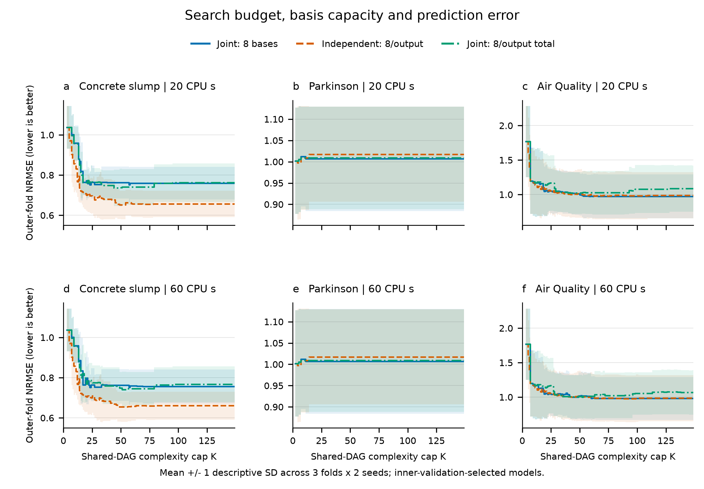
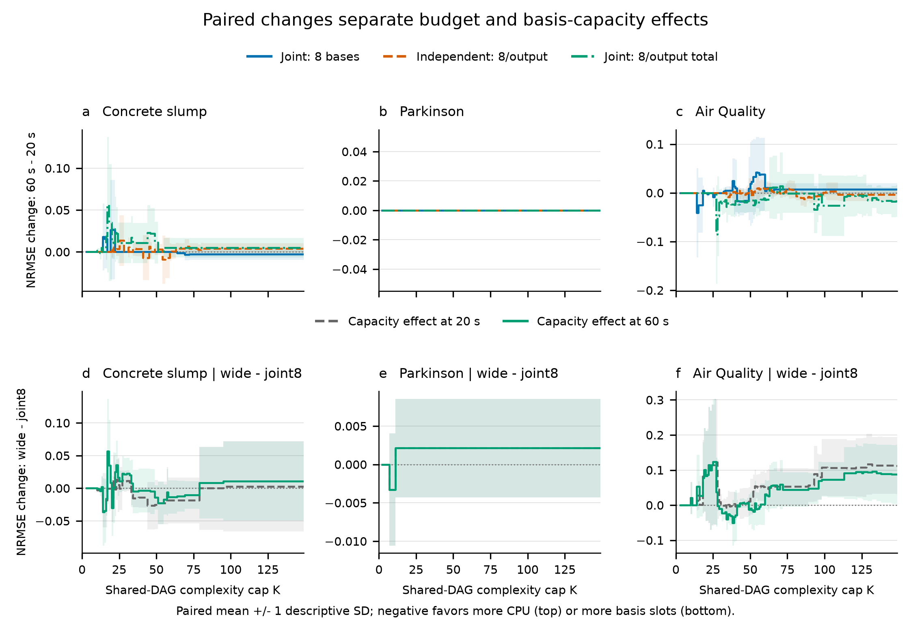

# Search-budget and basis-capacity diagnosis

This is the first diagnostic step after the v3 study, using the three existing
development datasets. It introduces no algorithm changes and no new blind
evaluation. The library defaults remain unchanged.

**The tested increases in time and basis slots do not resolve the joint
model's accuracy gap.** All 108/108 runs completed, with no timeout, failed
run or failed frontier prediction. At the default operating point, joint8's
equal-dataset mean NRMSE increased by **0.17%** when its CPU cap tripled.
Widening the joint basis bound increased error by **3.93% at 20 seconds** and
**2.89% at 60 seconds**, while increasing actual K by approximately 47%.

## Results

The following are default operating points, not models selected under a common
K cap. The equal-dataset mean weights each dataset equally.

| Dataset | Joint8: 20 / 60 s | Independent8: 20 / 60 s | Joint wide: 20 / 60 s |
| --- | ---: | ---: | ---: |
| Concrete slump | 0.759221 / 0.756290 | 0.660770 / 0.664886 | 0.762043 / 0.767245 |
| Parkinson | 1.006785 / 1.006785 | 1.017625 / 1.017625 | 1.008924 / 1.008924 |
| Air Quality | 0.972578 / 0.980197 | 0.982941 / 0.979778 | 1.075247 / 1.046507 |
| Equal-dataset NRMSE | **0.912861 / 0.914424** | **0.887112 / 0.887430** | **0.948738 / 0.940892** |
| Equal-dataset actual K | 32.22 / 34.89 | 41.50 / 43.50 | 47.39 / 51.50 |

Independent searches have 2.82% and 2.95% lower aggregate errors at these two
budgets, with 28.79% and 24.68% higher actual complexity. The advantage is
concentrated in concrete; independent search is slightly worse on Parkinson.
These are new paired runs with two seeds, so their means should not replace
the earlier five-seed v3 estimates.



Under a common cap, independent search has the lowest equal-dataset mean
NRMSE at **all seven prespecified caps at both CPU budgets**. This does not
mean every dataset or output favors it. At K=40, the results are:

| Dataset | Budget | Joint8 NRMSE / actual K | Independent8 NRMSE / actual K | Joint wide NRMSE / actual K |
| --- | ---: | ---: | ---: | ---: |
| Concrete slump | 20 s | 0.762997 / 24.50 | 0.679894 / 32.33 | 0.748731 / 29.33 |
| Concrete slump | 60 s | 0.762997 / 24.50 | 0.683265 / 31.83 | 0.759473 / 29.17 |
| Parkinson | 20 s | 1.006785 / 6.00 | 1.017625 / 5.83 | 1.008924 / 3.83 |
| Parkinson | 60 s | 1.006785 / 6.00 | 1.017625 / 5.83 | 1.008924 / 3.83 |
| Air Quality | 20 s | 1.027575 / 36.67 | 1.006809 / 39.00 | 1.024291 / 32.50 |
| Air Quality | 60 s | 1.037551 / 37.50 | 1.006701 / 38.33 | 1.008255 / 33.50 |

K=40 is one prespecified example; the complete tables and figure retain all
caps. The concrete independent advantage persists here in all six paired
cells, at 10.89% and 10.45% lower error. Equal caps still do not imply equal
realized K, as the table shows.



Three observations guide the next step:

1. **Extra time produces more search, but little transferable gain.** Joint8
   performs about 5,201 versus 14,497 head fits on average. Its default error
   decreases 0.39% on concrete, stays identical on Parkinson and increases
   0.78% on Air Quality. At K=40, concrete and Parkinson are unchanged; Air
   Quality worsens 0.97%. A threefold budget alone is not a supported fix.
2. **The eight-basis limit is not a sufficient explanation.** Concrete's
   default joint8 model reaches that limit in 0/6 runs at 20 seconds and 1/6
   at 60 seconds; Parkinson reaches it in 0/6 at either budget. Their training
   archives nevertheless reach eight bases in every run, so search did explore
   the bound. Air Quality's selected joint8 models reach it in 5/6 and 4/6
   runs, but widening the bound worsens default error by 10.56% and 6.77%.
3. **Capacity helps locally when complexity is controlled.** Wide joint search
   improves over joint8 at K=40 on concrete and Air Quality, but this gain does
   not persist at larger caps. On concrete at 20 seconds, widening reduces
   default train/inner NRMSE from 0.5453/0.6027 to 0.4544/0.5575, while outer
   error rises from 0.7592 to 0.7620. Better fitting and inner selection do not
   guarantee better generalization on these small or shifted partitions.

The evidence supports testing a more selective combination of shared and
output-specific expressions, together with stronger validation-based size
control, as a **separate next experiment**. It does not establish negative
transfer as the cause, prove that more than 60 seconds cannot help, or justify
adopting a new default. Widening changes search allocation as well as capacity;
only two seeds and three correlated folds were used here. No step-two algorithm
change was implemented in this diagnosis.

## Design and interpretation

The [protocol](../experiments/budget_capacity_v1/PROTOCOL.md), runners, source
hashes and nine split hashes were frozen in commit `51dc2af` before scoring.
Three datasets, three nested folds, two seeds, two CPU limits and three arms
give 108 runs. Each full output system receives 20 or 60 CPU seconds, with
single-thread numerical libraries and four concurrent run processes.

- **joint8** allows eight basis functions in the entire joint model.
- **independent8** allows eight per output, dividing the system's CPU allowance
  equally among output searches.
- **joint_wide** allows eight times the output count in one joint model.

The last arm changes the existing basis bound only. It matches an upper bound
on basis slots, not identical function classes or realized graph sizes. The
joint model already has separate coefficients for each output. Increasing its
basis bound also changes the allocation of a fixed search budget.

All other search parameters and v3 development partitions stay fixed. Parkinson
splits isolate subjects; Air Quality splits preserve time order with the same
gap. No Gas Turbine or SML holdout was scored again. These previously inspected
development observations cannot support another blind-test claim.

NRMSE divides each output RMSE by its fitting-set standard deviation, then
averages equally over outputs and fold/seed cells. K counts the union of exact,
value-aware expression DAG nodes plus nonzero head connections and intercepts.
Independent models receive the same credit for identical subexpressions.

Two operating-point definitions must be kept separate:

1. Default points retain v3 selection using inner-validation normalized MSE
   plus `0.0001*K`, separately for independent output searches.
2. Curves select minimum inner-validation MSE under each K cap, with ties
   favoring lower actual K. For independent searches, the full Cartesian
   product of retained output archives is enumerated before any outer scoring.

Outer-fold errors never select a model or an envelope. Curves represent the
retained, training-Pareto, domain-audited candidate set, not every expression
visited or a global optimum. A common K cap permits different actual K; both
are reported. Curves can worsen with increasing K on the outer fold.

Means use all six paired fold/seed cells per dataset. Shading is one descriptive
population SD, not an IID confidence interval. Prespecified K caps are
10, 20, 30, 40, 60, 80 and 120; the source files also cover every integer cap.
Failed or unattainable points remain in the records and incomplete groups do
not receive a partial mean.

## Runtime and checks

| Arm | CPU cap | Mean search CPU | Mean full fit CPU | Curve selection CPU | Curve/default scoring CPU |
| --- | ---: | ---: | ---: | ---: | ---: |
| Joint8 | 20 | 20.000 | 20.949 | 0.036 | 0.027 |
| Joint8 | 60 | 60.007 | 61.042 | 0.039 | 0.030 |
| Independent8 | 20 | 20.010 | 20.915 | 0.084 | 0.122 |
| Independent8 | 60 | 60.003 | 61.009 | 0.105 | 0.126 |
| Joint wide | 20 | 20.000 | 26.697 | 0.147 | 0.041 |
| Joint wide | 60 | 60.003 | 68.885 | 0.211 | 0.047 |

All times are seconds averaged over the 18 dataset/fold/seed cells per arm and
budget. The largest summed search overshoot was 0.015625 seconds. Full fit
includes validation, domain checks, serialization and model reload; curve
enumeration/selection and scoring are additional costs outside the search cap.
Widened joint models incur substantially higher fitting/audit overhead, so the
arms should not be described as having identical end-to-end cost.

All 126 tests pass. Reaggregation into a second directory reproduces all five
analysis files byte for byte. All 22 diagnostic frozen-file hashes and all
117 v3 frozen-file hashes match; old v1--v3 tracked records and algorithm source
are unchanged. Both figures pass rendered alignment, 7-point minimum glyph
size and collision checks, followed by visual inspection. The
[QA record](../experiments/budget_capacity_v1/figure_qa/QA.md) explains the three
nonblocking source-format warnings.

## Reproduction and evidence

The [complete tables](../experiments/budget_capacity_v1/analysis/TABLES.md) give
train/inner/outer errors, actual complexities and all prespecified cap results.
[Summary JSON](../experiments/budget_capacity_v1/analysis/summary.json),
[default CSV](../experiments/budget_capacity_v1/analysis/default.csv),
[full curves CSV](../experiments/budget_capacity_v1/analysis/curves.csv) and
[paired CSV](../experiments/budget_capacity_v1/analysis/paired.csv) preserve
per-output values, paired changes, spread and CPU accounting. Individual
[run directories](../experiments/budget_capacity_v1/runs) contain selected
models, complete retained candidate archives, hashes and process records.

With the project installed and the original development data prepared, verify
and rebuild the aggregation into a **new** directory:

```bash
python experiments/budget_capacity_v1/analyze.py --output outputs/capacity_recheck
```

It checks the frozen source/data, fold identities, all 108 result identities,
models and candidate archives before aggregation. It never refits or chooses
new models, and refuses to overwrite an existing analysis directory.
CPU-limited training is machine dependent; saved models identify the precise
results evaluated here. An independent retraining requires its own experiment
directory and provenance, rather than replacing these records.

Figure rendering uses a separate environment recorded in
`experiments/budget_capacity_v1/figure-environment.txt`:

```bash
python experiments/budget_capacity_v1/plot.py
```

Supply `--qa-scripts PATH` containing `audit_panel_alignment.py` to enable the
render-time alignment gate. This release additionally runs source, PDF glyph,
collision and visual audits; plain rendering alone does not claim those checks.
No raw numeric dataset files, fitted tree binaries or private source documents
are included in this diagnostic publication.
