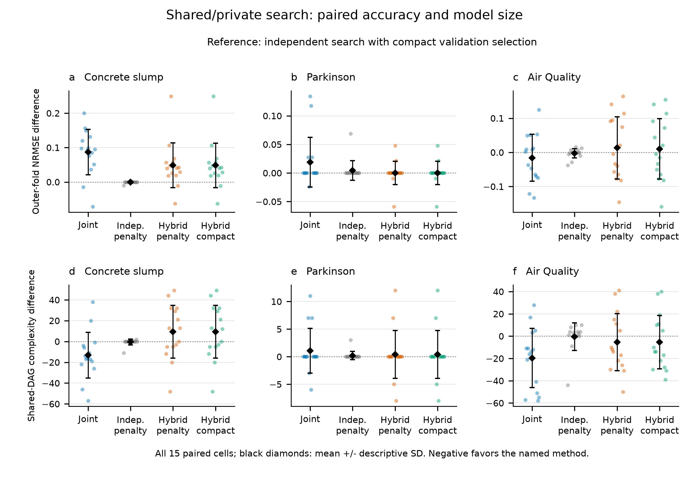

# Shared/private expressions with validation size control

**The prototype is implemented and verified, but did not pass its advancement
gate.** All **135/135 training runs** and **225/225 evaluations** succeeded.
The primary hybrid/compact model has **2.20% higher outer NRMSE** and **3.31%
higher shared-DAG complexity** than independent search with the same selector.
It therefore remains an experimental repository implementation; no default is
changed and no new blind test is claimed.

This implements the second development step after the budget/capacity
diagnosis. The prototype is in
[`experiments/shared_private_v1`](../experiments/shared_private_v1), while the
released library source and default behavior remain unchanged. Its saved
inference model uses the existing audited DimenSR-MIMO JSON format.

## Results and decision

All methods had the same 20-CPU-second system limit. The table gives equal
dataset means; NRMSE is lower-is-better and K is actual selected complexity.

| Search and selection | Outer NRMSE | K |
| --- | ---: | ---: |
| Original joint | 0.919639 | 31.78 |
| Independent, penalty | 0.890034 | 42.09 |
| Independent, compact | **0.889658** | 42.36 |
| Shared/private, penalty | 0.910195 | 43.82 |
| Shared/private, compact (primary candidate) | 0.909212 | 43.76 |

Relative to the original joint model, the primary candidate reduces error by
1.13% but increases complexity by 37.69%. This is not sufficient evidence of
an improved tradeoff, because the independent compact control has both lower
error and lower aggregate complexity.

| Dataset | Independent compact NRMSE / K | Hybrid compact NRMSE / K | Error change | K change |
| --- | ---: | ---: | ---: | ---: |
| Concrete slump | 0.662218 / 49.00 | 0.710646 / 58.27 | +7.31% | +18.91% |
| Parkinson | 1.004039 / 5.13 | 1.004116 / 5.53 | +0.008% | +7.79% |
| Air Quality | 1.002716 / 72.93 | 1.012875 / 67.47 | +1.01% | -7.50% |

The largest loss is on concrete: hybrid improves in only 2/15 paired cells
there. Across all datasets it has lower error in 12/45 cells; these are
descriptive counts, not independent trials. Air Quality offers a local
compression tradeoff, but the error increase and aggregate complexity result
do not meet the frozen advancement requirements.



The primary candidate fails both advancement routes: it does not achieve a
1% aggregate accuracy gain, nor a 10% aggregate complexity reduction within
the allowed 0.5% error increase. It also fails all three concrete output guards:

| Concrete output | Control NRMSE | Hybrid NRMSE | Increase | Allowed increase |
| --- | ---: | ---: | ---: | ---: |
| Slump | 0.902619 | 0.925217 | 0.022598 | 0.018052 |
| Flow | 0.831333 | 0.878235 | 0.046902 | 0.016627 |
| 28-day compressive strength | 0.252700 | 0.328485 | 0.075784 | 0.010000 |

The Parkinson and Air Quality output guards pass, and aggregate error is below
the original joint control. These partial successes do not override the failed
primary criteria. No alternate arm was substituted after observing results.

The selection ablation is small. Within hybrid's identical candidate pool,
compact selection changes error by -0.108% and K by -0.152%. Within independent
search, it changes error by -0.042% and K by +0.634%. Here, "compact" means
minimum K within a per-output loss tolerance; it does not guarantee a smaller
model than the different penalty rule. Selection alone does not close the gap.

The prototype does learn sharing: the selected hybrid averages 2.29 bases used
by multiple outputs, versus 0.60 for the independent compact control. Increased
sharing counts alone do not establish lower graph cost or better prediction.
The fixed shared anchor, four/private basis split and shorter private-search
allowance remain plausible limitations. This experiment does not isolate which
of them caused the deficit.

A useful subsequent experiment would retain the full independent candidate
solutions as a baseline and make sharing optional based on inner-validation
benefit. The current fixed allocation should not be promoted on these results.
That subsequent algorithm and any external validation were not executed here.

## Algorithm and controls

The prototype divides expression discovery into a shared dictionary and
per-output residual dictionaries. Each output head may use a refitted union of
shared and private bases, a private-only candidate, or a projected shared
candidate. Exact duplicate bases are stored once with output-specific
coefficients. Independent controls receive the same DAG sharing credit.

Within a 20-CPU-second system limit, 40% searches up to four shared bases and
40% searches up to four private bases per output, divided equally among outputs.
The remaining allowance covers training-only head refits. A shared anchor is
chosen from training loss and complexity alone. The raw training-box domain
checks remain in force; all training parameters are fixed before using inner
validation. This two-stage construction does not globally optimize every
possible shared/private decomposition.

The original joint and independent searches are rerun as controls. Independent
and hybrid candidate archives each produce two operating points:

- **Penalty:** original per-output inner normalized MSE plus `0.0001*K`.
- **Compact:** allow up to 1% above each output's own minimum inner MSE, then
  select the minimum shared-DAG complexity across the eligible combinations.
  Ties favor lower mean inner MSE. The tolerance is not a confidence interval.

The independent compact control tests whether the new search structure adds
value beyond changing selection alone. No extra model fitting occurs between
the two selectors, and no outer-fold score chooses either model.

The [protocol](../experiments/shared_private_v1/PROTOCOL.md) and training source
were frozen in commit `efbf0b8` before scoring. The study reuses the same three
development datasets and nine nested folds, with five seeds per fold. It has
135 training runs and five operating points per dataset/fold/seed cell, giving
225 evaluations. Group separation, chronological gaps, fitting-row caps and
training-only scaling match v3. No previously opened holdout is scored again;
these results are development evidence rather than another blind test.

NRMSE divides each output RMSE by its fitting-set target SD, then averages
equally over outputs and the 15 fold/seed cells per dataset. K is the union of
exact expression DAG nodes plus nonzero coefficients and intercepts. The three
datasets receive equal weight in overall means. Repeated seeds within folds
are correlated; descriptive SD is not an IID confidence interval.

## Runtime and verification

| Training arm | Mean training/search CPU | Mean fit CPU | Selection/audit CPU | Total CPU |
| --- | ---: | ---: | ---: | ---: |
| Joint | 20.000 | 20.991 | 0.000 | 21.041 |
| Independent | 20.011 | 20.944 | 0.052 | 21.087 |
| Shared/private | 16.224 | 16.716 | 0.524 | 17.349 |

Times are seconds per full output system. The two selectors share one training
run, so their CPU must not be added as separate experiments. For independent
and hybrid arms, total CPU includes both selectors, saved-model reload checks
and both evaluations. Joint selection is already included in its estimator's
fit time. Validation and final audits remain outside the training/search cap.
The largest summed search overshoot is 0.03125 seconds.

Hybrid consumes less than its cap because the reserved refit allowance finishes
early and unused time is not reassigned. Its residual search nominally receives
8/m seconds per output, versus 20/m for the independent control. This is a
comparison at equal caps, not equal consumed training time, and it does not
prove that shared/private models are inherently inferior. Future budget
reallocation would require a separate frozen experiment.

The full test suite passes **141 tests**, including synthetic shared/private
recovery, strict raw-domain rejection, graph-aware selection, JSON round trips,
gate boundaries and persistence of choices before outer scoring. A real
three-second synthetic demonstration produced validation NRMSE 0.00281/0.00211,
K=20, and exact reload predictions; this is engineering evidence only.
All four analysis outputs are byte-identical when rebuilt into a second
directory. The original v3 and first-step frozen files remain intact.

The figure passes strict rendered panel alignment, a 7-point minimum glyph
audit and collision checks with zero FAIL/WARN findings, followed by visual
inspection. [Figure QA](../experiments/shared_private_v1/figure_qa/QA.md) records
the three intentional source-format warnings. No success claim depends on
discarding failed runs or choosing a favorable subset of outputs.

## Using and reproducing the prototype

After cloning this repository and installing it into an isolated environment,
run the known synthetic example:

```bash
python -m pip install -e ".[dev]"
python experiments/shared_private_v1/demo.py --seconds 10 --output outputs/hybrid-demo.json
```

The example reports validation error, actual K and consumed training CPU, then
checks exact prediction equality after JSON reload. It refuses to overwrite an
existing output. This is an engineering demonstration, not blind evidence. The
saved model loads with `MIMOSymbolicRegressor.load(...)` and works with the
existing prediction CLI. The experimental trainer is a repository script, not
a new default estimator or a stable public training API.

Once the original development inputs have been prepared, rebuild the saved-run
analysis into a fresh directory without refitting:

```bash
python experiments/shared_private_v1/analyze.py --output outputs/shared-private-recheck
```

The script verifies frozen source/data, identities, split hashes, selected
models and candidate archives before applying the prespecified gates. Repeated
training under a CPU cap may vary across machines. A new training attempt needs
a new experiment directory, preserving these original records.

[Full tables](../experiments/shared_private_v1/analysis/TABLES.md),
[per-run and per-output scores](../experiments/shared_private_v1/analysis/scores.csv),
[paired changes](../experiments/shared_private_v1/analysis/paired.csv) and
[summary with advancement gates](../experiments/shared_private_v1/analysis/summary.json)
retain all outcomes. [Run records](../experiments/shared_private_v1/runs) contain
candidate archives, pre-scoring choices, portable models and hashes. Raw numeric
datasets and private source documents are excluded from publication.
